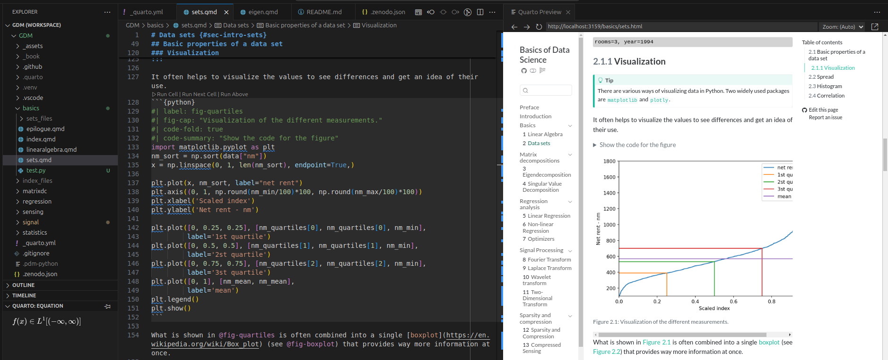
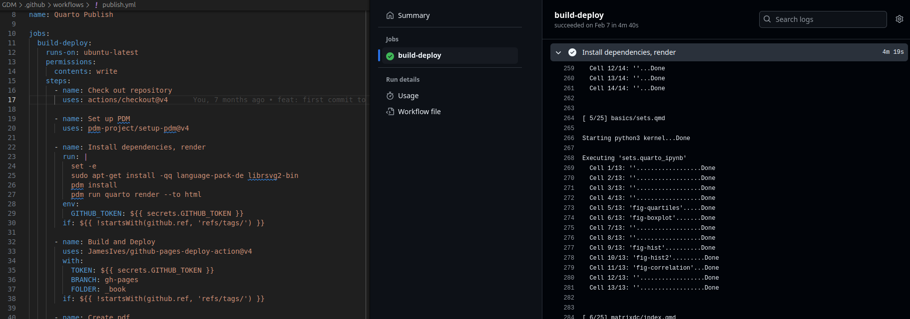
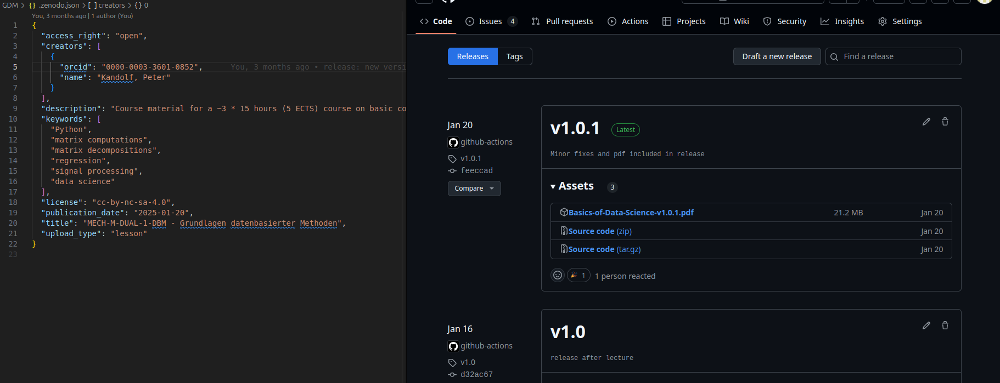

## The main idea of `Quarto`?

- Write plain text [markdown](https://en.wikipedia.org/wiki/Markdown) or [Jupyter](https://jupyter.org/) notebooks.
- Create dynamic content with Python, R, Julia, and more.
- Publish reproducible, production quality articles, books, presentations, websites, in HTML, PDF, MSWord, and more.
- Write using [Pandoc](https://pandoc.org/) markdown, including equations, citations, cross-references, figures, callouts and more.
- (Bonus) Create releases with a DOI as online resource.


## `Quarto` in action... writing content

:::: {.columns}

::: {.column}
- Formatting with **markdown**
- $\LaTeX{}: \quad a^2 + b^2 = 42$
- ::::: {.callout-tip}
  Something important
  :::::
- Code with output
  ```{python}
  #| echo: true
  import numpy as np
  a = np.random.rand(1)
  a
  ```
- and use it again later 
  `{python} float(np.round(a,2))`
:::

::: {.column} 
::::: {.fragment}
````qmd
- Formatting with **markdown**
- $\LaTeX{} \quad a^2 + b^2 = 42$
- ::::: {.callout-tip}
  Something important
  :::::
- Code with output
  ```{{python}}
  #| echo: true
  import numpy as np
  a = np.random.rand(1)
  a
  ```
- and use it again later 
  `{{python}} float(np.round(a,2))`

````
:::::
:::

::::


## `Quarto` in action... lecture notes for

[_Basics of Data Science_](https://kandolfp.github.io/MECH-M-DUAL-1-DBM/) and [_ML in Industrial Image Processing_](https://kandolfp.github.io/MECH-M-DUAL-2-MLB/)

::: {.incremental}

- A _book class_, i.e. multiple chapters/sections with consistent theme, style, and cross-references with bibliography.
- Heavy use of mathematics, i.e. $\LaTeX$ for formulas, definitions, equations, examples, exercises, etc..
- Heavy use of code, i.e. dynamic content; students can copy the code and get the same result.
- Use callout to draw attention to important parts or collapse to hide solutions.
- Hosted as static HTML on GitHub Pages.

:::


## {background-iframe="https://kandolfp.github.io/MECH-M-DUAL-1-DBM/basics/sets.html#visualization" background-interactive="true"}

## {background-iframe="https://kandolfp.github.io/MECH-M-DUAL-2-MLB/nn/nn.html#fig-nn-nn-dvc-non-linear" background-interactive="true"}

<!--
## `Quarto` in action... workflow

- Change content with a preview feature in your favourite editor (VS Code extension)
- Push to GitHub and start [`GitHub Actions`](https://github.com/features/actions)
  - Render to various outputs
  - Publish the new version
-->

## `Quarto` in action... workflow 1/3

Change content with a preview feature in your favourite editor (VS Code extension)

{fig-align="center"}

## `Quarto` in action... workflow 2/3

Render and publish via GitHub Actions

{fig-align="center"}

## `Quarto` in action... workflow 3/3

When you are happy with a version, create a release.
We use zenodo to publish with a DOI in the spirit of _Open Science_.

{fig-align="center"}

## Extensions makes it event greater

::: {style="font-size: 0.7em;"}
:::: {.qparson}
Sort the code from left to right into a working C function printing even numbers from 1 to 20.
```c
int main() {
    int i = 1;
    while (i <= 20) {
        if (i % 2 == 0) {
            printf("%d\n", i);
        }
        i = i + 1;
    }
    return 0;
}
```
::::
:::

## `Quarto` is great for...

::: {.incremental}
- Combining syntax highlighted code, results, narratives, formulas, inline results, and references in one place.
- Reproducibility and easy Pipelines for automatic updates.
- Rendering to multiple formats: HTML, PDF, MSWord, etc.
- Multi-page formats like books or docs with cross references.
- More fine grained layout and control of Jupyter notebooks.
- Better source control than Jupyter.
:::

## `Quarto` is NOT great for...

::: {.fragment fragment-index=1}
- Fully interactive and dynamic web-pages/apps.
:::

::: {.fragment fragment-index=3}
- WYSIWYG (the preview is amazing though)
:::


::: {.fragment fragment-index=2}
- Precise print formatting ($\LaTeX$).
:::

::: {.fragment fragment-index=4}
- Custom web development.
:::

::: {.fragment fragment-index=4}
- If you code/programming language is not supported natively (there are workarounds).
:::


## Thanks {.nostretch}

::: {.collumns}

:::: {.column width="60%"}
- `Quarto`: <https://quarto.org/>
- `zenodo`: <https://zenodo.org/>
- `GitHub Pages`: <https://pages.github.com/>
- Lecture 1: <https://kandolfp.github.io/MECH-M-DUAL-1-DBM/>
- Lecture 2: <https://kandolfp.github.io/MECH-M-DUAL-2-MLB/>
::::
:::: {.column width="35%"}

{width="50%"}

{width="56%"}
::::
:::

<!--
## `Quarto` in action... similar slides to pdf

```qmd
---
title: "`Quarto` for Lecture Material"
author: "Peter Kandolf"
date: 05.08.2025
format:
    pptx:
        reference-doc: Powerpoint_Vorlage_FFH25.pptx
        incremental: true
---

## What is this talk about?

Showcasing a modern open-source scientific and technical publishing system on _lecture notes_ with dynamic `Python` content.

::: {.incremental}
- Creation of lecture notes with `Quarto`
    - What is the main idea of `Quarto`?
    - When does it make sense to use `Quarto`
- `Quarto` in action - full workflow for a lecture
    - We start from a commit in `git`
    - Automatically build on _GitHub Pages_ for a static HTML
    - Create a new _release_  with a _DOI_ and output in multiple formats
:::
```
-->